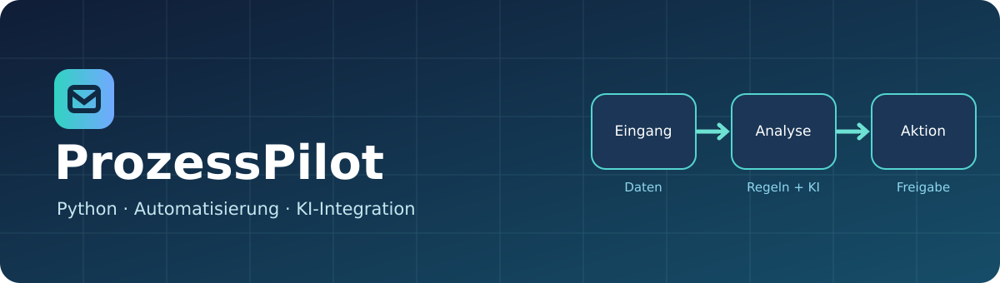
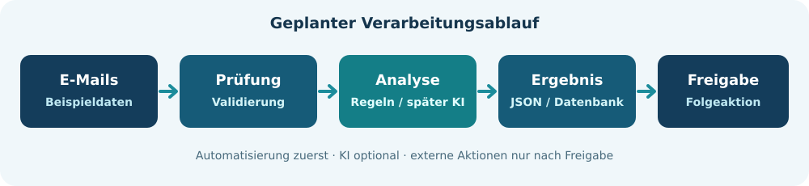

# ProzessPilot

**Python-basierte Automatisierung von Geschäftsprozessen – mit geplanter KI-Integration und Microservices-Architektur.**

## Über das Projekt

**ProzessPilot** ist ein Lern- und Entwicklungsprojekt zur Automatisierung wiederkehrender Geschäftsabläufe mit Python. Der Einstieg erfolgt über die Verarbeitung **fiktiver E-Mails**. Langfristig soll das System weitere Vorgänge wie Dokumente, Anfragen und Aufträge verarbeiten können.

Das Projekt wird schrittweise aufgebaut. Ziel ist es, Python-Grundlagen, robuste Automatisierung und später professionelle Backend-Architektur praktisch zu erlernen.

> **Entwicklungsstand:** Das Projekt befindet sich in der Planungs- und Anfangsphase. Die nachfolgend beschriebenen Funktionen sind Ziele und noch nicht als implementiert zu verstehen.

## Geplante Funktionen

- Eingehende E-Mail-Daten aus Beispieldateien einlesen
- Nachrichten nach Thema und Dringlichkeit klassifizieren
- Relevante Informationen strukturiert extrahieren
- Doppelte Vorgänge erkennen
- Bearbeitungsstatus und Ergebnisse speichern
- Abläufe protokollieren und automatisiert testen
- Später: KI-gestützte Analyse und Antwortentwürfe mit menschlicher Freigabe
- Später: REST-API und Aufteilung geeigneter Komponenten in Microservices

## Entwicklungsplan

| Phase | Schwerpunkt                                                    | Status  |
| ----- | -------------------------------------------------------------- | ------- |
| 1     | Python-Grundlagen und E-Mail-Automatisierung mit Beispieldaten | Geplant |
| 2     | Modularisierung, Datenspeicherung, Fehlerbehandlung und Tests  | Geplant |
| 3     | KI-gestützte Klassifizierung und Informationsgewinnung         | Geplant |
| 4     | Backend-API, Hintergrundaufgaben und mögliche Microservices    | Geplant |

Die detaillierten Aufgaben werden in [`Plan.txt`](Plan.txt) dokumentiert.

## Technische Ausrichtung

**Zum Einstieg:** Python, Standardbibliothek, JSON, Logging und `unittest` oder `pytest`.

**Für spätere Ausbaustufen (optional):** FastAPI, PostgreSQL, Pydantic, Docker sowie KI-APIs. Die konkrete Auswahl erfolgt nach Bedarf; nicht jede Technologie muss eingesetzt werden.

## Architekturidee

**Grundsatz:** Kritische oder externe Aktionen sollen nicht allein aufgrund einer ungeprüften KI-Ausgabe ausgeführt werden.

## Lokal starten

Eine ausführbare Anwendung ist derzeit noch nicht bereitgestellt. Sobald der erste lauffähige Stand vorhanden ist, werden hier die konkreten Installations- und Startbefehle ergänzt.

## Lernziele

- Verständliche, wiederverwendbare Python-Funktionen entwickeln
- Datenstrukturen und Dateiverarbeitung sicher beherrschen
- Fehlerfälle abfangen und nachvollziehbar protokollieren
- Automatisierte Tests schreiben
- Geschäftslogik von Schnittstellen und Speicherung trennen
- Später APIs und KI-Dienste zuverlässig integrieren

## Beispieldaten und Datenschutz

Für Entwicklung und Tests werden zunächst **ausschließlich fiktive Daten** verwendet. Echte E-Mail-Konten oder personenbezogene Geschäftsdaten sind nicht erforderlich. Zugangsdaten und API-Schlüssel gehören nicht ins Repository.

## Mitwirkung und Weiterentwicklung

Das Repository dokumentiert den Lern- und Entwicklungsfortschritt. Struktur und Funktionen können sich im Laufe der Umsetzung ändern.

## Grafiken

Die SVG-Grafiken liegen im Ordner [`assets/`](assets/) und werden direkt von GitHub dargestellt.
